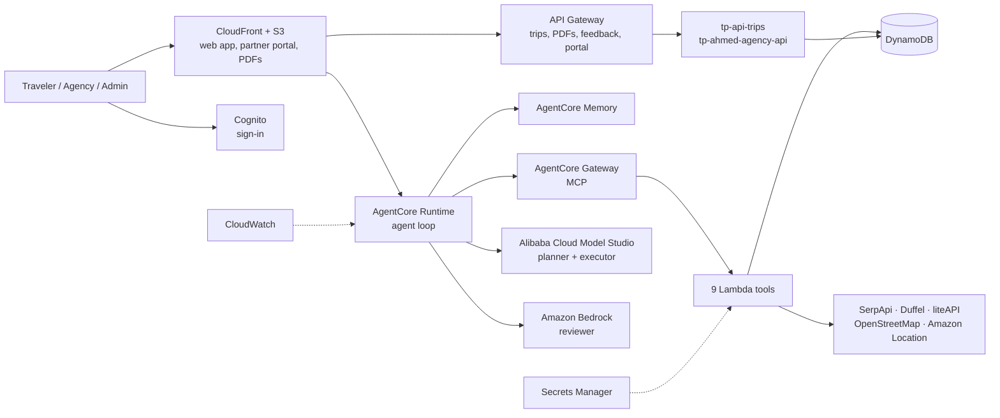

# Cloud-Based Agentic Travel Planning Platform

**CS5224 Cloud Computing · Project Group 10 · National University of Singapore**

A serverless SaaS on AWS that turns a plain-language trip request into a **checked, day-by-day itinerary** with live flight prices, booking links, a PDF and chat-based revisions. Language models propose the plan, deterministic code verifies every hard constraint, a reviewer model from a different provider scores the soft preferences, and any check that cannot be met is shown to the traveler instead of hidden.

- **Live site:** https://d1xdiycimlc3a.cloudfront.net
- **Region:** AWS ap-southeast-1 (Singapore)

| Team member |
|---|
| Alghaith Ahmed Ibrahim A |
| Alfallaj Abdulkarim Fahad |
| Alshamrani Ahmed Abdullah A |
| Lim Fang Eng |
| Yogi Sunanta |
| Aditya Tjitra Salim |

---

## Why this project

AI trip planners write fluent plans that are rarely checked. On the TravelPlanner benchmark, GPT-4 satisfied every stated constraint in only 0.6% of tasks, and at most 37% of travelers trust AI travel recommendations enough to act on them. We therefore treat travel planning as a **verification problem, not a generation problem**: given hard constraints (budget, dates, party size, must-visit places) and soft preferences (theme, pacing, cuisine, free time), the system delivers an itinerary built only from live supplier data, with every hard constraint checked in code.

**Design rule:** prices never come from a model. Every flight, hotel, transfer and place is looked up by ID in the candidate pool that the search tools saved, and the verifier and PDF re-read prices and names from there.

## Features

- **Plain-language requests via a form**, e.g. *"a nine-night Tokyo and Osaka honeymoon for two from Singapore on SGD 7,000"*. The agent asks one follow-up question if dates, travelers or budget are missing.
- **Real prices**: Google Flights fares via SerpApi (Duffel as fallback), hotels via Duffel Stays (liteAPI as fallback), places via OpenStreetMap (Amazon Location and Google Places as fallbacks).
- **Code-checked plans**: budget, dates, flight times, opening hours, travel times, pacing, duplicates, unknown IDs, multi-city chains and must-visit places.
- **Independent reviewer**: a model from a different provider than the planner scores preference fit, theme, pacing and variety.
- **Automatic repair**: a failing plan is corrected and re-checked; the best version is kept and remaining issues are shown as caveats.
- **Single- and multi-city trips**, pinned places, an already-booked hotel, day trips, diet, accessibility and pacing preferences.
- **Chat revisions**: each change creates a new, re-checked version with its own PDF.
- **Background planning**: a plan keeps running on the server if the browser disconnects or the phone locks, and the page picks up the result when it returns ([docs/background-planning.md](docs/background-planning.md)).
- **Memory**: preferences are stored per user in AgentCore Memory and recalled on the next trip.
- **Partner portal**: travel agencies and local guides register, an administrator approves them, and approved packages appear next to the custom plan.
- **Trip history and a feedback panel** on every plan (overall rating, five user-study questions and comments).

## Architecture

The web tier, agent runtime, tools and data run on serverless AWS services in ap-southeast-1. The planner and executor models are called on Alibaba Cloud Model Studio (Singapore) and the reviewer through Amazon Bedrock.



| Service | Role |
|---|---|
| Amazon S3 + CloudFront | Hosts the web app, partner portal and generated PDFs |
| Amazon Cognito | Sign-in; every trip and memory record is keyed to the user's identity |
| Amazon API Gateway | Trip history, PDF, feedback and partner-portal endpoints; throttling for tenant isolation |
| Amazon Bedrock AgentCore Runtime | Runs the Python agent loop |
| Amazon Bedrock AgentCore Gateway | Exposes the nine Lambda tools to the agent over MCP |
| Amazon Bedrock AgentCore Memory | Stores long-term user preferences |
| Amazon Bedrock | Reviewer model (Kimi K3) |
| AWS Lambda | 11 functions: 9 agent tools plus the trips API and the partner-portal API |
| Amazon DynamoDB | Search cache and candidate pool, trips, itineraries and feedback |
| Amazon Location Service | Geocoding and travel times |
| AWS Secrets Manager | Third-party API keys (never stored in this repository) |
| Amazon CloudWatch | Logs, traces and per-plan metrics |
| AWS CodePipeline + CodeBuild | Tests and deploys every push to `main` |

## The agent loop

The agent follows the **LLM-Modulo** pattern: propose, verify, judge, repair.

```
request ─► parse constraints ─► parallel searches ─► candidate pool (DynamoDB, stable IDs)
                                                          │
             ┌────────────────────────────────────────────┘
             ▼
        1. PROPOSE   planner picks flights, stays and places by ID only
        2. VERIFY    Lambda code checks every hard constraint, with a repair hint per failure
        3. JUDGE     reviewer from another provider scores fit 1–5; pass = 4+ on every criterion
        4. REPAIR    executor fixes the defects, then verify + judge run again
             │       (up to 3 rounds; best version kept)
             ▼
        deliver plan + caveats + PDF + booking links
```

### Model configurations

We compared 20 planner / executor / reviewer configurations on cost and independently judged plan quality. The website runs configuration `combo_19`, loaded from `agent/public-model-config.json` through the `PUBLIC_MODEL_CONFIGURATION` environment variable (see `agent/launch.example.sh`): Qwen 3.8 Max (Alibaba) as planner, DeepSeek V4.1 Flash (Alibaba) as executor and Kimi K3 (Bedrock) as reviewer.

Benchmark results for the two chains from the report:

| Chain | Planner / Executor / Reviewer | Score /10 | USD per plan |
|---|---|---|---|
| Quality (deployed, `combo_19`) | Qwen 3.8 Max / DeepSeek V4.1 Flash / Kimi K3 | 7.433 | 0.0342 |
| Low-cost (planned free tier, not deployed) | Qwen 3.8 Flash / Qwen 3.8 Flash / Gemini 3.5 Flash Lite | 7.133 | 0.0045 |

An independent evaluator (Kimi K3) can score delivered plans out of 10; it is off unless `FINAL_EVALUATOR_ENABLED=true`. Model spend is tracked per configuration in an S3 budget ledger (`MODEL_BUDGET_BUCKET`, `MODEL_BUDGET_LEDGER`).

## Tools (AgentCore Gateway targets)

| Tool | Lambda | Purpose |
|---|---|---|
| `search_flights` | `tp-search-flights` | Google Flights via SerpApi, Duffel fallback |
| `search_stays` | `tp-search-stays` | Duffel Stays, liteAPI fallback |
| `find_places` | `tp-find-places` | OpenStreetMap Overpass, Amazon Location and Google Places fallbacks |
| `search_transfers` | `tp-search-transfers` | Flights or ground transfers between cities on multi-city trips |
| `route_matrix` | `tp-route-matrix` | Travel times between stops |
| `sequence_day` | `tp-sequence-day` | Orders a day's stops around opening hours |
| `verify_itinerary` | `tp-verify-itinerary` | Deterministic hard-constraint checks |
| `render_pdf` | `tp-render-pdf` | Builds the itinerary PDF, with CJK font support |
| `search_agency_packages` | `tp-ahmed-search-packages` | Approved agency and guide packages that match the request |

Two more Lambdas sit behind API Gateway rather than the agent: `tp-api-trips` (trip history, PDFs, feedback, background-run status) and `tp-ahmed-agency-api` (partner registration, packages and admin approval).

## Repository layout

```
agent/            agent loop (tp_travel_agent.py), MCP Gateway client, prompts, model adapter
                  and configurations, background jobs, launch.example.sh, Dockerfile
lambdas/          one folder per Lambda (11); schemas/ holds the 9 Gateway tool schemas,
                  test-events/ a console test event per function
shared/           money, currency and opening-hours helpers shared by the agent and Lambdas
web/              the traveler website (index.html + JS modules); web/agency/ the partner
                  portal and admin pages
tests/offline/    offline suites with fake AWS and a fake Gateway (run_all.sh)
tests/            website tests (Node), partner-portal tests and the Gateway smoke test
scripts/          deploy.py (used by CodeBuild), create_lambdas.sh, build_zips.sh,
                  publish_web.sh, font-layer and prompt-export scripts
infra/            IAM policies for the agent, tools, Gateway and deploy pipeline
docs/             AWS resources, CI/CD, background planning, auth recovery and
                  the 13 prompt texts (docs/prompt-management/)
assets/fonts/     fonts for the PDF layer
buildspec.yml     CodeBuild: offline tests, then deploy what changed
.github/workflows GitHub Actions: offline tests and model tests on every push / PR
```

## Getting started

### Run the tests locally (no AWS account or API keys needed)

```bash
pip install requests boto3
bash tests/offline/run_all.sh
```

Everything runs in mock mode against a fake Gateway with the model calls stubbed. The same suite runs in GitHub Actions on every push and pull request, and in CodeBuild before every deployment.

### Deploy your own copy

Prerequisites: an AWS account in ap-southeast-1 with access to Amazon Bedrock AgentCore, the AgentCore CLI, and API keys for SerpApi, Duffel, liteAPI and Alibaba Cloud Model Studio.

1. **Create the data and identity resources**: DynamoDB tables (cache and candidate pool, trips, itineraries, feedback), S3 buckets for the website and PDFs, a Cognito user pool, and Secrets Manager secrets for the API keys and the Gateway client. Keep every key out of the repository.
2. **Create the Lambda functions** from CloudShell:
   ```bash
   bash scripts/create_lambdas.sh
   ```
3. **Register the nine tools** from `lambdas/schemas/` as targets of an AgentCore Gateway, and test them with `tests/gateway_smoke_test.py`.
4. **Deploy the agent** to AgentCore Runtime. `launch.sh` is git-ignored; it holds resource names and secret *names*, never secret values:
   ```bash
   cd agent
   cp launch.example.sh launch.sh   # fill in the <...> values
   chmod +x launch.sh && ./launch.sh
   ```
5. **Publish the website** (`web/`) to the S3 bucket behind CloudFront with `scripts/publish_web.sh`.
6. **Connect CodePipeline** to this repository. From then on, every push to `main` runs the offline tests in CodeBuild (`buildspec.yml`) and deploys what changed with `scripts/deploy.py`; if the tests fail, nothing is deployed. See [docs/cicd.md](docs/cicd.md).

Team workflow (branches, pull requests and reviews) is in [CONTRIBUTING.md](CONTRIBUTING.md).

## Evaluation highlights

- **Model selection:** 20 configurations compared; the quality chain scores **7.433/10 at USD 0.034 per plan**, and the low-cost chain **7.133/10 at USD 0.0045**. The experiments cost USD 12.61 in total.
- **Grounding:** delivered totals match retrieved supplier values by construction.
- **Testing:** offline suites run in GitHub Actions and CodeBuild before every deployment, plus a smoke test through the real Gateway. Five functional tests on the deployed app (provider registration and approval, invalid input, thin-data destinations, very low budget, editing a saved plan) passed, two with notes.
- **User evaluation (early):** 7 participants, 10 ratings, mean overall rating **3.9 / 5** (each participant counted once). Across 61 plans since the latest release, the median plan time was **83 s** and 90% were ready within two minutes.

## Cost

A plan costs **USD 0.034 (free tier) to 0.098 (paid tier)**, including model calls, flight searches and AWS services; flight search, not AI, is the largest cost. At 10,000 plans a month the cost of goods sold is about USD 541, with no up-front investment, against about USD 24,300 a month for an equivalent on-premise GPU deployment.

## Limitations

- A reviewer (Kimi K3) error ends the turn in strict mode and caused most failed live turns.
- SerpApi's free plan allows 250 searches a month; beyond that, flights fall back to Duffel test offers labelled as sample fares.
- Preferences are stored in DynamoDB and AgentCore Memory, and some model calls run outside Singapore, so a public launch needs a PDPA-compliant privacy policy, retention rules and explicit consent.
- The model comparison rests on three matched cases with unequal first-round coverage.
- Payments and in-platform ticketing are out of scope.

## Future work

Affiliate booking links, more hotel and rail inventory, scoring on the public TravelPlanner benchmark, a load test of the elastic scaling, infrastructure as code with the AWS CDK, and streaming a first draft while the checks run.

## AI tool usage

We used Anthropic's Claude as an assistant for parts of the code (agent, Lambda tools, deployment scripts), the AWS documentation and report editing. All AI-assisted output was reviewed, tested on AWS and edited by the team; the design decisions, evaluation and conclusions are our own.

## Acknowledgements

Built for CS5224 Cloud Computing at the National University of Singapore. The verify-judge-repair design follows the LLM-Modulo framework (Gundawar et al., 2024) and is evaluated with ideas from the TravelPlanner benchmark (Xie et al., ICML 2024).
